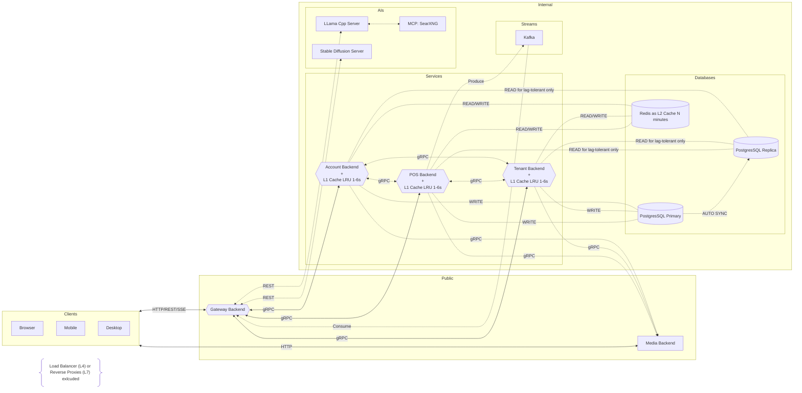
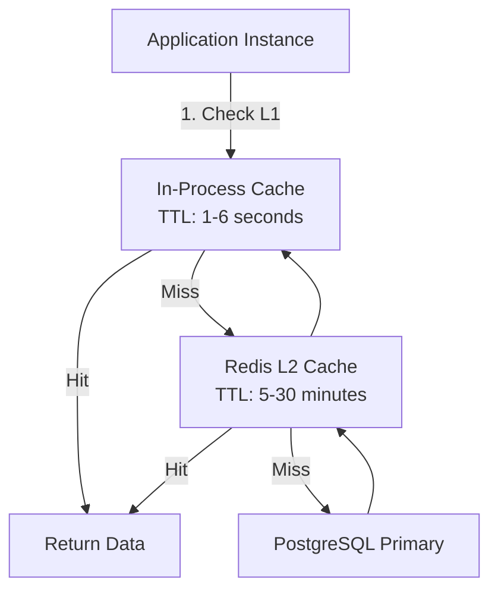

# FnB POS AI

A FnB POS AI Powered project.

<br>

# Table of contents

- [Capabilities](/#capabilities)
- [Getting Started](/#getting-started)

<br>

---

## Capabilities

TBA
<!--
[ ] Single tenant with multi branch.
[ ] Offline capability when internet down.
[ ] Multi taxes for branch customer orders.
[ ] Kitchen & Bar monitoring process for orders.
[ ] AI assist for image generation and description.
[ ] Multi registers/cashiers for high trafic store orders.
[ ] Auto deduct stock when order created with items builder.
-->

<br>

---

## Getting Started

TBA

<br>

---

## Backend

### Account

__*Project Directory:*__ `fnbposai-be-account`.

<br>

PORTS: [10001].

<br>

---

### AI

__*Project Directory:*__ `fnbposai-be-ai`.

<br>

__*IMPORTANTS:*__

- Don't expose to public facing.
- Stable diffusion server currently don't have allow origin in sd-server.

<br>

#### Llama Cpp

Repo: https://github.com/ggml-org/llama.cpp

Ports: [9931].

<br>

#### Stable Diffusion Cpp
Repo: https://github.com/leejet/stable-diffusion.cpp

Ports: [1234].

Notes:
- Currently auto generate image is simple prompt,
  in the future, the AI Generate button should show the prompt for the actual input.

<br>

#### MCP SearXNG

Repo: https://github.com/searxng/searxng

Ports: [8080].

<br>

---

### Gateway

__*Project Directory:*__ `fnbposai-be-gateway`.

<br>

PORTS: [9001].

<br>

---

### Media

__*Project Directory:*__ `fnbposai-be-media`.

<br>

PORTS: [9002].

<br>

---

### POS

__*Project Directory:*__ `fnbposai-be-pos`.

<br>

PORTS: [10002].

<br>

---

### Tenant

__*Project Directory:*__ `fnbposai-be-tenant`.

<br>

PORTS: [10003].

<br>

---

## Frontend

### POS Client

__*Project Directory:*__ `fnbposai-fe-pos`.

<br>

PORTS: [4200].

<br>

---

## Database

### SQL

__*Engine:*__ `PostgreSQL 18.x`.

<br>

__*Project Directory:*__ `containers/postgresql`.

<br>

__*Init Container Entries Dir:*__ `containers/postgres-primary/init`.

<br>

__*Verify Dummies Data:*__

Required to run `make gen-dummies` and make sure the postgres primary and replica is up.<br>
[See Makefile](./Makefile) for reference command.

```sql
\pset pager off

select
    pi.name                         as item_name,
    poi.quantity,
    poi.price_at_order,
    pop.method                      as payment_method,
    pop.paid_at
from pos_orders_payments pop
join pos_orders          po  on po.id        = pop.id_order
join pos_orders_items    poi on poi.id_order = pop.id_order
join pos_items           pi  on pi.id        = poi.id_item
where pop.status = 'paid'
  and pop.paid_at >= date_trunc('month', current_date - interval '1 month')
  and pop.paid_at <  now()
  and po.id_tenant         = '01a14e6f-ab53-74d4-af99-f9e541108ba0'
  and po.id_tenant_branch  = '01a14e70-c4b6-70bb-b65a-899d4a53fc9d'
order by pop.paid_at desc;
```

```sql
select method, count(*), sum(total)
from pos_orders_payments
group by method
order by method;
```

<br>

__*IMPORTANTS:*__

- Primary for write replica for read.
- All database initialization happen on the the database.
- Don't add complexity handle initialize from backend service/s.
- Never use `select * ...`. Limit your query, pick what's important.
- All service/s that interact with database handle the logic and type checking only.

<br>

PORTS: [5432].

<br>

---

### NoSQL

__*Engine:*__ `Redis 8.x`.

<br>

__*Project Directory:*__ `containers/redis`.

<br>

__*IMPORTANTS:*__

- TTL always use jitter.

<br>

PORTS: [6379].

<br>

---

## Broker/Stream

### Kafka

__*Engine:*__ `Kafka 4.x`.

<br>

__*Project Directory:*__ `containers/kafka`.

<br>

__*IMPORTANTS:*__

- Only gateway who consume what produced.

<br>

PORTS: [9032].

<br>

---

## Systems Flowchart



__*NOTES:*__

- Not all service/s become producer.
- Cache (L1 & L2) need to use TTL + jiter.
- Always validate if cache L1 & L2 miss then update it.
- For "hot data" it can be cache in L1 for 6s TTL + jiter.

<br>

`cache flow:`


<br>

---

###### end of readme
