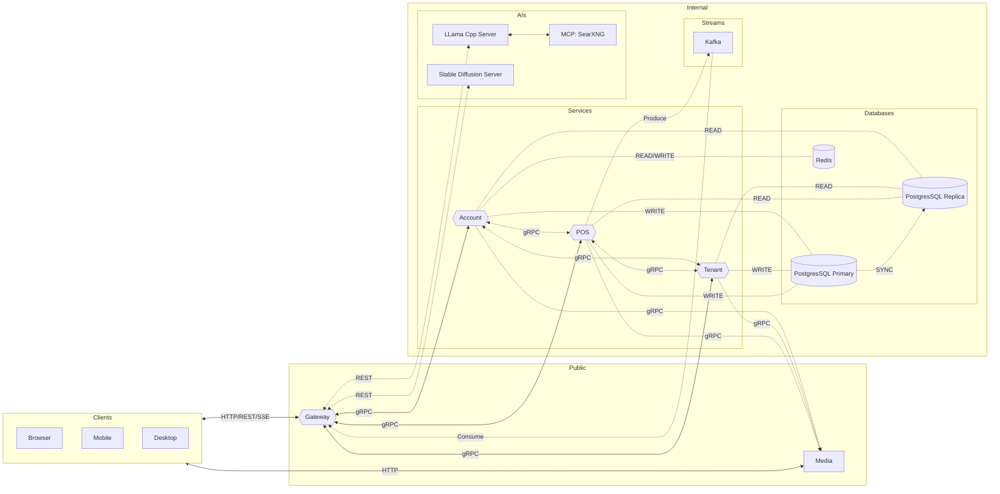

# FnB POS AI

A FnB POS AI Powered project.

 

# Table of contents

- [Capabilities](/#capabilities)
- [Getting Started](/#getting-started)

 

---

## Capabilities

TBA
<!--
[ ] Single tenant with multi branch.
[ ] Offline capability when internet down.
[ ] Multi taxes for branch customer orders.
[ ] Kitchen & Bar monitoring process for orders.
[ ] AI assist for image generation and description.
[ ] Multi registers/cashiers for high trafic store orders.
[ ] Auto deduct stock when order created with items builder.
-->

 

---

## Getting Started

TBA

 

---

## Backend

### Account

TBA

 

---

### AI

__*Project Directory:*__ `fnbposai-be-ai`.

 

__*IMPORTANTS:*__

- Don't expose to public facing.
- Stable diffusion server currently don't have allow origin cli args.

 

#### Llama Cpp

Repo: https://github.com/ggml-org/llama.cpp

Ports: [9931].

 

#### Stable Diffusion Cpp
Repo: https://github.com/leejet/stable-diffusion.cpp

Ports: [1234].

Notes:
- Currently auto generate image is simple prompt,
  in the future, the AI Generate button should show the prompt for the actual input.

 

#### MCP SearXNG

Repo: https://github.com/searxng/searxng

Ports: [8080].

 

---

### Gateway

TBA

 

---

### Media

TBA

 

---

### POS

TBA

 

---

### Tenant

TBA

 

---

## Frontend

### POS Client

TBA

 

---

## Database

### SQL

__*Engine:*__ `PostgreSQL 18.x`.

 

__*Project Directory:*__ `containers/postgresql`.

 

__*IMPORTANTS:*__

- Primary for write replica for read.
- All database initialization happen on the the database.
- Don't add complexity handle initialize from backend service/s.
- Never use `select * ...`. Limit your query, pick what's important.
- All service/s that interact with database handle the logic and type checking only.

 

---

### NoSQL

__*Engine:*__ `Redis 8.x`.

 

__*Project Directory:*__ `containers/redis`.

 

__*IMPORTANTS:*__

- TTL always use jitter.

 

---

## Broker/Stream

### Kafka

__*Engine:*__ `Kafka 4.x`.

 

__*Project Directory:*__ `containers/kafka`.

 

__*IMPORTANTS:*__

- Only gateway who consume what produced.

 

---

## Systems Flowchart

 

---

###### end of readme
